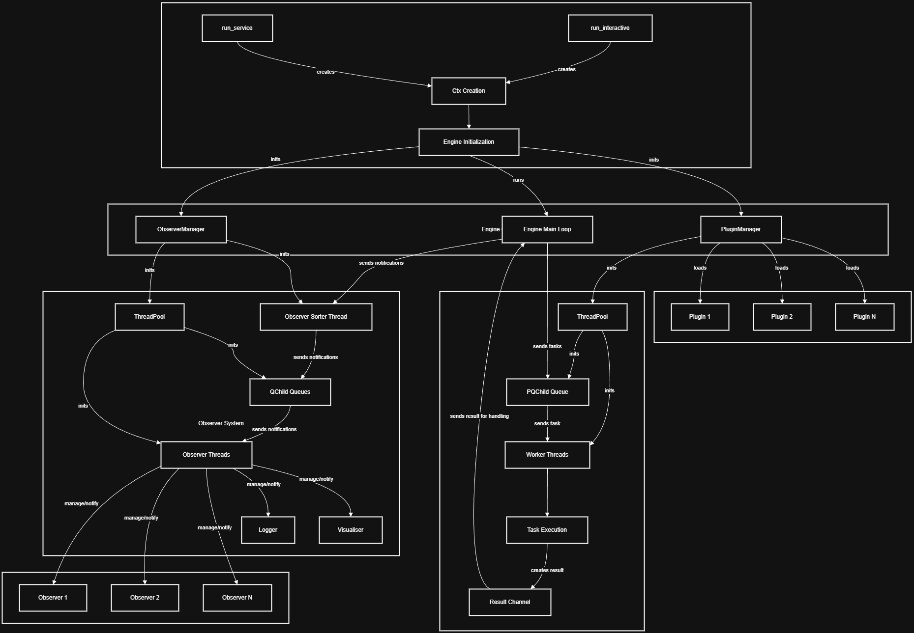

# Thryve Task Manager

A high-performance, extensible task management and execution framework written in Rust. Thryve provides a robust architecture for managing concurrent task execution, event-driven notifications, and modular plugin-based extensions.

## Table of Contents

- [Overview](#overview)
- [Architecture](#architecture)
- [Core Concepts](#core-concepts)
- [Modules](#modules)
- [Configuration](#configuration)
- [Usage](#usage)
- [Building](#building)
- [License](#license)

## Overview

Thryve is designed around three main pillars:

1. **Task Execution**: Submit tasks with priorities to a thread pool for concurrent execution
2. **Observer Pattern**: Event-driven notification system for decoupled component communication
3. **Plugin System**: Extensible architecture allowing dynamic functionality addition

### Key Features

- **Priority-based scheduling** with aging mechanism to prevent task starvation
- **Typed tasks with follow-ups and joins**: a task's value, or its own error, goes to the task declared after it with `then`, and several tasks can share one follow-up with `join`, so plugins combine without knowing each other
- **Graceful shutdown** with pause/resume capabilities
- **Thread-safe** concurrent data structures using `crossbeam`
- **Configurable** via TOML with sensible defaults
- **Extensible** through plugins and observers
- **Production-ready** logging with timestamped, categorized output
- **Graph visualization** for task topology analysis (debug mode)

## Architecture



### Data Flow

1. **Tasks** enter through the task channel and are queued by priority
2. **Worker threads** execute tasks from the priority queue
3. **Results** are sent back to the engine for processing; a typed task's result goes on to its follow-up, or into its join
4. **Notifications** flow through the observer system for logging and monitoring

## Core Concepts

### Tasks

Tasks are units of work submitted to the engine for execution:

```rust
use thryve_utils::packets::task::Task;
use thryve_utils::res::TaskResult;

let task = Task::new("MyTask", 2, || {
    // Task execution logic
    TaskResult::new("Success", "Task completed".to_string(), "Main")
}).expect("valid task name");
```

**Task Properties:**
- **Unique ID**: Automatically assigned for tracking
- **Name**: Human-readable identifier
- **Priority**: Higher values = more urgent (0-14)
- **Execution Function**: Closure returning a `TaskResult`

### Results

Results represent task execution outcomes and enable task chaining:

```rust
use thryve_utils::res::TaskResult;
use thryve_utils::packets::task::Task;

// Terminal result
let result = TaskResult::new("Success", "Done".to_string(), "Main");

// Chained result — executes the next task once this one completes
let next_task = Task::new("NextTask", 1, || {
    TaskResult::new("Ok", "".to_string(), "Main")
}).expect("valid task name");
let chained = TaskResult::new("Chained", "Moving on".to_string(), "Main").chain(next_task);
```

### Typed Tasks and Follow-ups

A typed task, `AdvTask<T, E>`, returns `Result<T, E>`: a value, or its own error type. Sending it returns a handle, and `then` on the handle declares a follow-up: a task of its own that runs once the first one finishes, and gets its value or its error as a `Handoff`:

```rust
use thryve_utils::packets::packet_handle::PacketHandle;
use thryve_utils::packets::task::AdvTask;
use thryve_utils::res::Handoff;

fn size_in_kb(handle: &PacketHandle) -> Result<(), Box<dyn std::error::Error>> {
    let file_size = AdvTask::new("FileSize", 2, || {
        std::fs::metadata("photo.png").map(|meta| meta.len())
    })?;

    handle
        .send_adv_task(file_size)?
        .then("SizeInKb", |handoff| match handoff {
            Handoff::Value(bytes) => Ok(bytes / 1024),
            // `FileSize`'s own error, a `std::io::Error`, passed on to whoever follows.
            Handoff::Error(error) => Err(error),
        })?;

    Ok(())
}
```

- **Chains:** `then` returns the follow-up's handle, so steps chain. A task has one follow-up: `then` uses its handle up.
- **Timing:** `then` works before or after the task finishes, since the engine keeps the result while the handle exists. Dropping a handle without `then` lets the result go, and an error is written to `Error.log`.
- **Priority:** a follow-up inherits its task's priority, capped below realtime. `then_with_priority` gives it its own.
- **Forwarding:** a task that creates its last step while it runs can forward to it with `AdvTask::forward` (or `then_forward`). It returns that step's handle, and whoever follows the task gets the step's result.
- **Independent plugins:** a plugin exports functions that send its typed tasks and return their handles. The code that uses two plugins wires them together with `then`, so neither plugin names the other.

Plain `Task`s and `chain` keep working for fire-and-forget work.

### Joins

Several typed tasks of one type can share one follow-up with `join`. It uses their handles up, and its closure gets a `JoinHandoff`: every value, in the order of the handles, or the first error and the position of the task that failed:

```rust
use thryve_utils::packets::packet_handle::PacketHandle;
use thryve_utils::packets::task::{AdvTask, join};
use thryve_utils::res::JoinHandoff;

fn total_size(handle: &PacketHandle) -> Result<(), Box<dyn std::error::Error>> {
    let mut sizes = Vec::new();
    for path in ["a.png", "b.png", "c.png"] {
        let file_size = AdvTask::new("FileSize", 2, move || {
            std::fs::metadata(path).map(|meta| meta.len())
        })?;
        sizes.push(handle.send_adv_task(file_size)?);
    }

    join(sizes, "TotalSize", |joined| match joined {
        // Every file's size, in the order of `sizes`.
        JoinHandoff::Filled { values } => Ok(values.iter().sum::<u64>()),
        // The first `FileSize` that failed, with its own `std::io::Error`.
        JoinHandoff::Error { error, .. } => Err(error),
    })?;

    Ok(())
}
```

- **Fails fast:** the join runs as soon as one task fails. The other tasks still run, and nobody takes their results: an error is written to `Error.log`.
- **A follow-up like any other:** `join` returns the join's own handle, so the join can be followed with `then`, or be one of the tasks of another join. It waits for each task whether that task finished before the join was declared or after, and a task that forwards fills its slot with the result of the task it forwarded to.
- **Priority:** the join inherits the highest priority among its tasks, capped below realtime. `join_with_priority` gives it its own.
- **Splitting has a cost:** joins of joins let work be split, and split again: ten images, each split into rows, and the rows' results archived into one zip. But every piece is a task of its own, with its own trip through the queue, its own result and its own slot, and every join adds one more task. Splitting finer than the work needs adds that overhead without making anything faster, so aim for a balance: enough pieces to keep the workers busy, each big enough to be worth a task.

### Observers

Observers are long-running components that process notifications:

```rust
use thryve_observers::logger::LoggerObserver;
use thryve_utils::cfg::config::Config;
use thryve_run::run::run_interactive::summon_requirements;

let ctx = summon_requirements(Config::load_def_config());
let logger = LoggerObserver::new(&ctx);
```

### Plugins

Plugins extend functionality without modifying the core:

```rust
use thryve_utils::errors::ThryveError;
use thryve_utils::traits::plugin_logic::PlgLogic;
use thryve_utils::impl_as_any;

// Implement PlgLogic for your plugin
struct MyPlugin;

impl PlgLogic for MyPlugin {
    fn clean_up(&self) -> Result<(), ThryveError> {
        // Cleanup logic
        Ok(())
    }

    impl_as_any!(MyPlugin);
}
```

## Modules

### thryve_core

The central runtime engine coordinating all components.

| Component | Description |
|-----------|-------------|
| `Engine` | Main execution loop, coordinates plugin and observer managers |
| `PluginManager` | Manages plugins, uses priority queue for task scheduling |
| `ObserverManager` | Manages observers, routes notifications via sorter thread |

### thryve_utils

Core utilities, data structures, and traits.

| Component | Description |
|-----------|-------------|
| `Task` | Unit of work with priority and unique ID |
| `AdvTask` / `AdvTaskHandle` | Typed task returning `Result<T, E>`, and the handle its follow-ups are declared on (`then`, `then_with_priority`, `then_forward`) |
| `join` / `join_with_priority` | One follow-up for several typed tasks of one type, which runs with all their values, or as soon as one fails |
| `Notif` | Notification structure for observer communication |
| `Log` | Logging notification implementation |
| `TaskResult` | Task execution outcome with chaining capability |
| `Handoff` | What a follow-up gets: the task's value, or its own error |
| `JoinHandoff` | What a join's follow-up gets: every task's value, in order, or the first error and the position of the task that failed |
| `ThreadPool` | Generic thread pool for tasks and notifications |
| `PQChild` | Priority queue with aging mechanism |
| `QChild` | Segmented queue for notifications |
| `Plugin` | Plugin structure |
| `Observer` | Observer structure |
| `Config` | Configuration structures |
| `Ctx` | Application context |

### thryve_observers

Built-in observer implementations.

| Component | Description |
|-----------|-------------|
| `LoggerObserver` | File-based logging with timestamped output |

### thryve_run

Service initialization and execution.

| Component | Description |
|-----------|-------------|
| `Service` | Windows service wrapper |
| `RunInteractive` | Interactive mode execution |

## Configuration

Configuration is loaded from a TOML file with `Config::load_config_from_file`, or the defaults are used with `Config::load_def_config()`.

A config file must set every key shown below. A missing or unknown key is rejected with its line, and so are values that would break the engine: `idle_wait`, `shutdown_grace_period`, `worker_count`, `aging_interval`, and the three pipe capacities and per-turn limits must be at least 1, and `max_priority` must be 14 or lower. All invalid values are reported in one error. Loading never falls back to the defaults on its own; that's the caller's choice.

### Default Configuration

This complete file holds the defaults:

```toml
[service]
can_stop = true
can_pause = true

[engine]
idle_wait = 100
shutdown_grace_period = 10

[threads]
worker_count = 4

[pipes]
task_pipe_capacity = 1024
tasks_processed_per_turn = 500
notif_pipe_capacity = 1024
notifs_processed_per_turn = 500
res_pipe_capacity = 1024
res_processed_per_turn = 500

[tasks]
max_priority = 4
aging_interval = 3

[debugging]
is_debugging = false
wait_before_execution = 10
visual_graph= false
calculate_metrics= false
log_tasks= false
```

### Configuration Options

| Section | Option | Type | Default | Description |
|---------|--------|------|---------|-------------|
| `service` | `can_stop` | bool | true | Accept stop commands |
| `service` | `can_pause` | bool | true | Accept pause/resume commands |
| `engine` | `idle_wait` | u64 | 100 | How long (ms) an idle engine waits for work before it checks its loop's flags (the service's Stop, Pause, Resume) again; anything that arrives wakes it at once |
| `engine` | `shutdown_grace_period` | usize | 10 | Seconds the shutdown waits for running tasks; a task still running then is named in `Error.log` and left behind, and the plugins aren't cleaned up |
| `threads` | `worker_count` | usize | 4 | Number of worker threads |
| `pipes` | `task_pipe_capacity` | usize | 1024 | Task channel buffer size |
| `pipes` | `tasks_processed_per_turn` | usize | 500 | Most tasks the engine takes per turn of its loop; the rest wait for the next turn |
| `pipes` | `notif_pipe_capacity` | usize | 1024 | Notification channel buffer size |
| `pipes` | `notifs_processed_per_turn` | usize | 500 | Most notifications the engine takes per turn |
| `pipes` | `res_pipe_capacity` | usize | 1024 | Result channel buffer size |
| `pipes` | `res_processed_per_turn` | usize | 500 | Most results the engine takes per turn |
| `tasks` | `max_priority` | u8 | 4 | Maximum task priority (0-14) |
| `tasks` | `aging_interval` | u64 | 3 | Seconds before priority boost |
| `debugging` | `is_debugging` | bool | false | Enable debug mode |
| `debugging` | `wait_before_execution` | u64 | 10 | Debug wait time (seconds) |
| `debugging` | `visual_graph` | bool | false | Enable task topology graph visualization |
| `debugging` | `calculate_metrics` | bool | false | Enable metrics calculation |
| `debugging` | `log_tasks` | bool | false | Enable task execution logging |

## Usage

### Creating a Simple Task

```rust
use thryve_utils::packets::task::Task;
use thryve_utils::res::TaskResult;
use thryve_utils::packets::packet_handle::PacketHandle;
use thryve_utils::errors::ThryveError;

fn send_calculation(handle: &PacketHandle) -> Result<(), ThryveError> {
    let task = Task::new("CalculateSum", 1, || {
        let result = 2 + 2;
        TaskResult::new("Success", format!("Result: {}", result), "Main")
    })?;

    // Fails only once the engine is gone; the task is then dropped.
    handle.send_task(task)
}
```

### Creating a Plugin

The idiomatic pattern is to give your plugin's logic type its own `new` that builds and returns the whole `Plugin` — rather than a separate free function:

```rust
use std::sync::Arc;
use thryve_utils::bases::plugin::Plugin;
use thryve_utils::errors::ThryveError;
use thryve_utils::traits::plugin_logic::PlgLogic;
use thryve_utils::impl_as_any;
use thryve_utils::packets::packet_handle::PacketHandle;
use thryve_utils::res::TaskResult;

struct MyPlugin;

impl MyPlugin {
    pub fn new(tx: PacketHandle) -> Plugin {
        let core = Arc::new(Self);
        let core_clone = Arc::clone(&core);
        let tx_clone = tx.clone();

        // The task job calls back into the plugin's own logic, so it has
        // access to whatever state the plugin needs.
        let entry_point = move || core_clone.task_a(tx_clone);

        Plugin::new("MyPluginType", core, tx, entry_point).expect("valid plugin type")
    }

    fn task_a(&self, _tx: PacketHandle) -> TaskResult {
        TaskResult::new("Success", "Task A completed".to_string(), "Main")
    }
}

impl PlgLogic for MyPlugin {
    fn clean_up(&self) -> Result<(), ThryveError> {
        println!("Cleaning up plugin");
        Ok(())
    }

    impl_as_any!(MyPlugin);
}
```

### Creating an Observer

Observers follow the same self-constructing pattern as plugins:

```rust
use std::sync::Arc;
use thryve_utils::bases::observer::Observer;
use thryve_utils::traits::observer_logic::ObsLogic;
use thryve_utils::traits::queue::Queue;
use thryve_utils::extras::jobs::ObsJob;
use thryve_utils::impl_as_any;
use thryve_utils::packets::packet_handle::PacketHandle;

struct MyObserver;

impl MyObserver {
    pub fn new(tx: PacketHandle) -> Observer {
        let core = Arc::new(Self);

        let run_fn = ObsJob::new(move |observer: Arc<Observer>| {
            loop {
                if observer.exit_flag.load(std::sync::atomic::Ordering::Relaxed) {
                    return;
                }

                // `pop` waits for the next notification. It returns `None` once the
                // queue is finalized at shutdown.
                let Some(_notif) = observer.obs_queue.pop() else {
                    return;
                };

                // Handle the notification.
            }
        });

        Observer::new("MyObserverType", core, run_fn, tx).expect("valid observer type")
    }
}

impl ObsLogic for MyObserver {
    fn clean_up(&self, _observer: Arc<Observer>) {
        println!("Cleaning up observer");
    }

    impl_as_any!(MyObserver);
}
```

### Full Sample Service

These restate the same `MyPlugin`/`MyObserver` shape from [Creating a Plugin](#creating-a-plugin) and [Creating an Observer](#creating-an-observer) so the sample is fully self-contained. Marked `no_run` since actually executing it attempts to install and run a real Windows service.

```rust,no_run
use std::sync::Arc;
use thryve_run::run::run_service;
use thryve_utils::cfg::config::Config;
use thryve_utils::bases::plugin::Plugin;
use thryve_utils::bases::observer::Observer;
use thryve_utils::traits::plugin_logic::PlgLogic;
use thryve_utils::traits::observer_logic::ObsLogic;
use thryve_utils::traits::queue::Queue;
use thryve_utils::errors::{ThryveError, get_err};
use thryve_utils::extras::jobs::ObsJob;
use thryve_utils::packets::packet_handle::PacketHandle;
use thryve_utils::res::TaskResult;
use thryve_utils::impl_as_any;

struct MyPlugin;
impl MyPlugin {
    pub fn new(tx: PacketHandle) -> Plugin {
        let core = Arc::new(Self);
        let core_clone = Arc::clone(&core);
        let tx_clone = tx.clone();
        let entry_point = move || core_clone.task_a(tx_clone);
        Plugin::new("MyPluginType", core, tx, entry_point).expect("valid plugin type")
    }
    fn task_a(&self, _tx: PacketHandle) -> TaskResult {
        TaskResult::new("Success", "Task A completed".to_string(), "Main")
    }
}
impl PlgLogic for MyPlugin {
    fn clean_up(&self) -> Result<(), ThryveError> {
        Ok(())
    }
    impl_as_any!(MyPlugin);
}

struct MyObserver;
impl MyObserver {
    pub fn new(tx: PacketHandle) -> Observer {
        let core = Arc::new(Self);
        let run_fn = ObsJob::new(move |observer: Arc<Observer>| {
            loop {
                if observer.exit_flag.load(std::sync::atomic::Ordering::Relaxed) {
                    return;
                }

                // `pop` waits for the next notification. It returns `None` once the
                // queue is finalized at shutdown.
                let Some(_notif) = observer.obs_queue.pop() else {
                    return;
                };

                // Handle the notification.
            }
        });
        Observer::new("MyObserverType", core, run_fn, tx).expect("valid observer type")
    }
}
impl ObsLogic for MyObserver {
    fn clean_up(&self, _observer: Arc<Observer>) {}
    impl_as_any!(MyObserver);
}

fn main() {
    let config = Config::load_def_config();
    let (svc, mut ctx) = run_service::create_service(config);

    let plugin = MyPlugin::new(ctx.packet_handle());
    let observer = MyObserver::new(ctx.packet_handle());

    ctx.plugins.push(plugin);
    ctx.observers.push(observer);

    // A TestFile is added to the logging files.
    ctx.logging_file_names.push("TestFile".to_string());

    // A failed start has already stopped every thread it started, and its error is in
    // Error.log once the log folder exists. Under the service manager stderr goes nowhere,
    // but the exit code is recorded.
    if let Err(e) = run_service::try_run_as_service(svc, ctx) {
        eprintln!("{}", get_err(&e));
        std::process::exit(1);
    }
}
```

### Full Sample Interactive

```rust,no_run
use std::sync::Arc;
use thryve_run::run::run_interactive;
use thryve_utils::cfg::config::Config;
use thryve_utils::bases::plugin::Plugin;
use thryve_utils::bases::observer::Observer;
use thryve_utils::traits::plugin_logic::PlgLogic;
use thryve_utils::traits::observer_logic::ObsLogic;
use thryve_utils::traits::queue::Queue;
use thryve_utils::errors::{ThryveError, get_err};
use thryve_utils::extras::jobs::ObsJob;
use thryve_utils::packets::packet_handle::PacketHandle;
use thryve_utils::res::TaskResult;
use thryve_utils::impl_as_any;

struct MyPlugin;
impl MyPlugin {
    pub fn new(tx: PacketHandle) -> Plugin {
        let core = Arc::new(Self);
        let core_clone = Arc::clone(&core);
        let tx_clone = tx.clone();
        let entry_point = move || core_clone.task_a(tx_clone);
        Plugin::new("MyPluginType", core, tx, entry_point).expect("valid plugin type")
    }
    fn task_a(&self, _tx: PacketHandle) -> TaskResult {
        TaskResult::new("Success", "Task A completed".to_string(), "Main")
    }
}
impl PlgLogic for MyPlugin {
    fn clean_up(&self) -> Result<(), ThryveError> {
        Ok(())
    }
    impl_as_any!(MyPlugin);
}

struct MyObserver;
impl MyObserver {
    pub fn new(tx: PacketHandle) -> Observer {
        let core = Arc::new(Self);
        let run_fn = ObsJob::new(move |observer: Arc<Observer>| {
            loop {
                if observer.exit_flag.load(std::sync::atomic::Ordering::Relaxed) {
                    return;
                }

                // `pop` waits for the next notification. It returns `None` once the
                // queue is finalized at shutdown.
                let Some(_notif) = observer.obs_queue.pop() else {
                    return;
                };

                // Handle the notification.
            }
        });
        Observer::new("MyObserverType", core, run_fn, tx).expect("valid observer type")
    }
}
impl ObsLogic for MyObserver {
    fn clean_up(&self, _observer: Arc<Observer>) {}
    impl_as_any!(MyObserver);
}

fn main() {
    let config = Config::load_def_config();
    let mut ctx = run_interactive::summon_requirements(config);

    let plugin = MyPlugin::new(ctx.packet_handle());
    let observer = MyObserver::new(ctx.packet_handle());

    ctx.plugins.push(plugin);
    ctx.observers.push(observer);

    // A TestFile is added to the logging files.
    ctx.logging_file_names.push("TestFile".to_string());

    match run_interactive::run_interactive(ctx) {
        Ok(handle) => {
            let _ = handle.join();
        }
        // A failed start has already stopped every thread it started. Its error is also
        // written to Error.log once the log folder exists.
        Err(e) => eprintln!("{}", get_err(&e)),
    }
}
```

## Graph Visualization (Debug Feature)

When enabled via the `visual_graph` configuration option, Thryve automatically tracks task creation points and builds a topology graph showing how tasks call each other.

### How It Works

1. **Call Site Capture**: When a task is sent (`send_task`) or chained (`chain`), the system records the file path and line number of that call. The compiler passes them in (`#[track_caller]`), so they're exact in every build, with or without debug info. A function of yours that wraps `send_task` is the call site for every task it sends, unless you mark it `#[track_caller]` too.
2. **Fingerprint Generation**: Each call site is assigned a unique fingerprint based on its location
3. **Graph Building**: The [`TopologyHandlerObserver`](thryve_observers/src/topology_handler.rs) receives notifications and builds a graph where:
   - **Nodes** represent call sites where tasks are created
   - **Edges** represent parent-child task relationships
   - **Edge weights** represent how many times a call path was taken
4. **Visualization**: On shutdown, the graph is exported to a RON file and a GUI viewer is launched

### When Graph Mode Fails

Graph mode is a debugging aid, so a failure in it never stops the engine:

- If the graph would be wrong from some point on, graph mode turns off until the program restarts, with a warning in `Error.log`. That happens when an edge points to a node that isn't in the graph, or the graph's lock was poisoned. The graph recorded so far is still exported. It ends with a *failure node* that says why, linked from the node where the failure happened.
- Smaller problems are handled on the spot and noted in `Error.log`: outside a cargo workspace, file paths stay absolute; a failed export or viewer launch is reported, and the shutdown goes on.

### Enabling Graph Visualization

In your configuration file:

```toml
[debugging]
is_debugging = true
visual_graph = true
```

### Architecture

The graph visualization system consists of:

| Component | Description |
|-----------|-------------|
| [`TaskCallSite`](thryve_utils/src/graphs/callsite.rs) | Represents a single call site with file path, line number and task name |
| [`TaskTopology`](thryve_utils/src/graphs/graph.rs) | Maintains the graph structure using petgraph's StableGraph |
| [`TopologyModifier`](thryve_utils/src/packets/notif_topology.rs) | Notification type for adding nodes and edges |
| [`TopologyHandlerObserver`](thryve_observers/src/topology_handler.rs) | Observer that maintains the graph and exports it on shutdown |


## Building

### Prerequisites

- Rust 1.85+ 
- Cargo

### Build Commands

```bash
# Build in release mode
cargo build --release

# Run tests
cargo test

# Build documentation
cargo doc --open
```

### Dependencies

Key dependencies:

- `crossbeam` - Lock-free concurrent data structures
- `chrono` - Date/time formatting
- `serde` - Configuration deserialization
- `toml` - TOML parsing
- `crossbeam-skiplist` - Priority queue implementation

## Priority Queue Details

The priority queue uses an aging mechanism to prevent starvation:

```text
effective_priority = min(base_priority + aging_boost, max_priority)
```

Where `aging_boost` increases based on wait time. Tasks inserted with a priority of more than 80% of max priority are treated as "realtime" and prioritized over newer tasks.

## Log Output Format

```text
Log_Creation: 2024-01-15 10:30:45, [ LOGGING ], Event_Type: Log, Message: Hello
```

Logs are organized by module:
```text
log/
  2024_01_15_10_30/
    Main.log
    Error.log
    <Module>.log
```

If a shutdown cuts work short, one line says how much:

```text
thryve exited leaving 3 things not done: 1 lost tasks, 0 lost notifications, 1 lost task results, 1 still running
```

It counts the tasks that never ran, the results that carried something (a message, or a task, plugin or observer to start), the notifications that were never delivered, and the threads still running when the grace period ran out. It goes to `Error.log`, or to `Main.log` when the Windows service was stopped, since stopping mid-work is expected there. With debugging on, `Debug.log` lists what was lost. A shutdown that lost nothing writes no line.

## License

Thryve is dual-licensed under two models:

### Open-Source License (AGPL-3.0)

For open-source projects and personal use, Thryve is available under the **GNU Affero General Public License v3.0**.

This means you can:
- ✅ Use Thryve freely in open-source projects
- ✅ Modify the source code
- ✅ Distribute the software
- ✅ Use it for learning and research

Conditions:
- 🔹 You must release your modifications under AGPL-3.0
- 🔹 You must make source code available when distributing
- 🔹 If used over a network (SaaS), you must make source code available to users

See the [`LICENSE`](./LICENSE) file for the full license text.

### Commercial License

For closed-source commercial projects that cannot comply with AGPL-3.0 requirements:

- 🔒 Keep your source code private
- 🔒 No requirement to disclose modifications
- 🔒 Suitable for proprietary SaaS applications

**Contact for licensing:** [thryve-framework.com](https://thryve-framework.com)

See [`COMMERCIAL.md`](COMMERCIAL.md) for more information.

---

**Choosing a license:**
- Open-source project? → Use **AGPL-3.0** (free)
- Closed-source commercial product? → Need **Commercial License** (paid)
- Unsure? → Contact us for guidance

## Contributing

Contributions are welcome! This project uses a **Contributor License Agreement (CLA)** to ensure that contributors grant necessary rights for both open-source and commercial licensing.

### Before You Contribute

1. **Read the CLA**: By submitting a pull request, you agree to the Contributor License Agreement
2. **Understand the architecture**: Review the [Architecture](#architecture) section
3. **Check existing issues**: See if your feature/bug is already discussed

### How to Contribute

#### 1. Fork and Clone

```bash
git clone https://github.com/JoJoAbdellatif/Thryve.git
cd Thryve
```

#### 2. Create a Branch

```bash
git checkout -b feature/your-feature-name
# or
git checkout -b fix/your-bug-fix
```

#### 3. Make Your Changes

Follow Rust best practices:
- Write clear, idiomatic Rust code
- Add documentation comments (`///`) for public APIs
- Ensure code is formatted: `cargo fmt`
- Run clippy: `cargo clippy -- -D warnings`

#### 4. Test Your Changes

```bash
# Run all tests
cargo test

# Run tests with coverage (if configured)
cargo test --all-features
```

#### 5. Submit a Pull Request

- Provide a clear description of changes
- Reference related issues
- Ensure CI passes
- Wait for CLA verification (automated)
- Address review feedback

### CLA (Contributor License Agreement)

By contributing to Thryve, you agree to:

1. **Grant License**: You grant the project maintainers a perpetual, worldwide, non-exclusive, royalty-free license to use, modify, and distribute your contribution
2. **Ownership Representation**: Your contributions are your original work or you have permission to contribute them
3. **Patents**: You grant patent rights for your contributions

The CLA ensures that:
- Contributors retain copyright ownership
- Maintainers can include contributions in both AGPL and Commercial licenses
- The project can be commercially licensed without legal barriers

### Code Style

- Follow [Rust API Guidelines](https://rust-lang.github.io/api-guidelines/)
- Use `cargo fmt` for formatting
- Document public items with `///` comments
- Use meaningful variable and function names

### Questions?

- Open an issue for discussions
- Contact maintainers for architectural questions

---

**Thank you for contributing to Thryve!**
