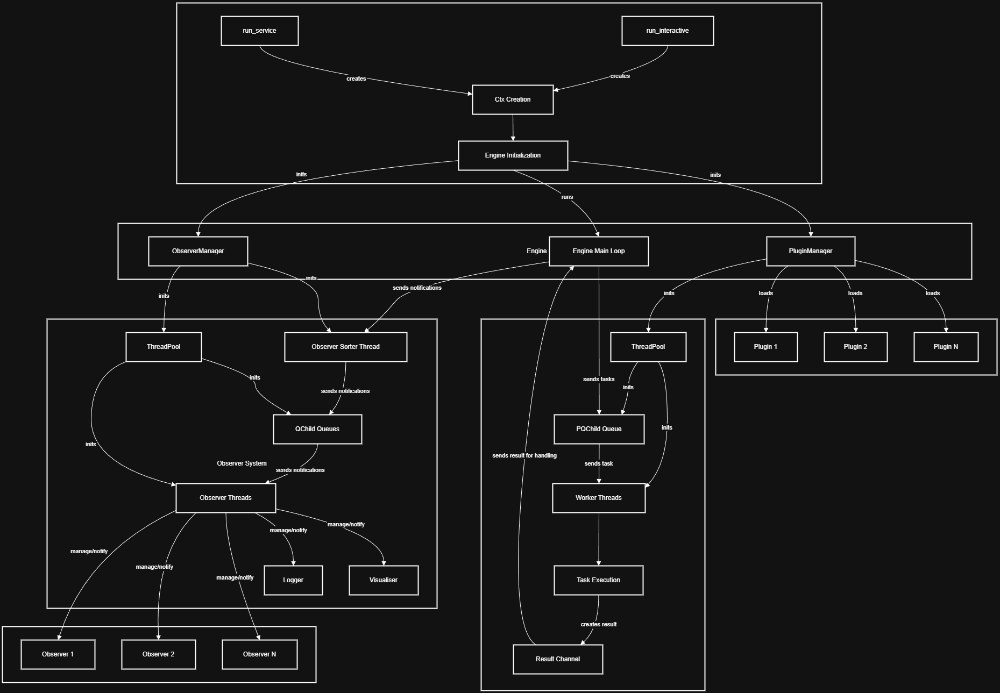

# Thryve

A high-performance, extensible task management and execution framework written in Rust. Thryve provides a robust architecture for managing concurrent task execution, event-driven notifications, and modular plugin-based extensions.

This is the main entry point crate for using Thryve from Rust — it re-exports the pieces of the framework you need under a single dependency. If you're integrating from C, C++, or another native language instead, see [`thryve_ffi`](https://crates.io/crates/thryve_ffi).

## Installation

```bash
cargo add thryve
```

Thryve builds on Windows only, for now. What changed in each release is in the [changelog](https://github.com/thryveframework/thryve/blob/main/CHANGELOG.md).

## Table of Contents

- [Overview](#overview)
- [Architecture](#architecture)
- [Core Concepts](#core-concepts)
- [Public API](#public-api)
- [Configuration](#configuration)
- [Usage](#usage)
- [License](#license)

## Overview

Thryve is designed around three main pillars:

1. **Task Execution**: Submit tasks with priorities to a thread pool for concurrent execution
2. **Observer Pattern**: Event-driven notification system for decoupled component communication
3. **Plugin System**: Extensible architecture allowing dynamic functionality addition

### Key Features

- **Priority-based scheduling** with aging mechanism to prevent task starvation
- **Typed tasks with follow-ups, splits, joins and fan-out**: a task's value, or its own error, goes to the task declared after it with `then`; work splits over several tasks with `split_into`, several tasks share one follow-up with `join`, and several follow-ups share one result with `fan_out`, so plugins combine without knowing each other
- **Cancelling**: `cancel` on a typed task's handle keeps a task that hasn't started from running, and the work that only it needed stops too: the tasks a join still waits for, the tasks a follow-up's chain was waiting on, and the task a fan-out group follows once every follower is cancelled
- **Graceful shutdown** with pause/resume capabilities
- **Thread-safe** concurrent data structures using `crossbeam`
- **Configurable** via TOML with sensible defaults
- **Extensible** through plugins and observers
- **Production-ready** logging with timestamped, categorized output
- **Graph visualization** for task topology analysis (debug mode)
- **Runs interactively or as a Windows service**

## Architecture



### Data Flow

1. **Tasks** enter through the task channel and are queued by priority
2. **Worker threads** execute tasks from the priority queue, and skip the ones that were cancelled
3. **Results** are sent back to the engine for processing; a typed task's result goes on to its follow-up, into its join, or to a fan-out group's followers
4. **Notifications** flow through the observer system for logging and monitoring
5. **Status messages**, Thryve's own, travel on a fourth channel that never makes a sender wait: status lines for the logger, the releases of dropped task handles, cancels, and fan-out groups' data

## Core Concepts

### Tasks

Tasks are units of work submitted to the engine for execution:

```rust
use thryve::utils::packets::task::Task;
use thryve::utils::res::TaskResult;

let task = Task::new("MyTask", 2, || {
    // Task execution logic
    TaskResult::new("Success", "Done".to_string(), "Main")
}).expect("valid task name");
```

**Task Properties:**
- **Unique ID**: Automatically assigned for tracking
- **Name**: Human-readable identifier
- **Priority**: Higher values = more urgent (0-14)
- **Execution Function**: Closure returning a `TaskResult`

### Results

Results represent task execution outcomes and enable task chaining:

```rust
use thryve::utils::res::TaskResult;
use thryve::utils::packets::task::Task;

// Terminal result
let result = TaskResult::new("Success", "Done".to_string(), "Main");

// Chained result — executes the next task once this one completes
let next_task = Task::new("NextTask", 1, || {
    TaskResult::new("Ok", "".to_string(), "Main")
}).expect("valid task name");
let chained = TaskResult::new("Chained", "Moving on".to_string(), "Main").chain(next_task);
```

### Typed Tasks and Follow-ups

A typed task, `AdvTask<T, E>`, returns `Result<T, E>`: a value, or its own error type. Sending it returns a handle, and `then` on the handle declares a follow-up: a task of its own that runs once the first one finishes, and gets its value or its error as a `Handoff`:

```rust
use thryve::utils::packets::packet_handle::PacketHandle;
use thryve::utils::packets::task::AdvTask;
use thryve::utils::res::Handoff;

fn size_in_kb(handle: &PacketHandle) -> Result<(), Box<dyn std::error::Error>> {
    let file_size = AdvTask::new("FileSize", 2, || {
        std::fs::metadata("photo.png").map(|meta| meta.len())
    })?;

    handle
        .send_adv_task(file_size)?
        .then("SizeInKb", |handoff| match handoff {
            Handoff::Value(bytes) => Ok(bytes / 1024),
            // `FileSize`'s own error, a `std::io::Error`, passed on to whoever follows.
            Handoff::Error(error) => Err(error),
        })?;

    Ok(())
}
```

- **Chains:** `then` returns the follow-up's handle, so steps chain. A task has one follow-up: `then` uses its handle up. To give one result to several follow-ups, see [Fan-out](#fan-out).
- **Timing:** `then` works before or after the task finishes, since the engine keeps the result while the handle exists. Dropping a handle without `then` lets the result go, and an error is written to `Error.log`.
- **Priority:** a follow-up inherits its task's priority, capped below realtime. `then_with_priority` gives it its own.
- **Forwarding:** a task that creates its last step while it runs can forward to it with `AdvTask::forward` (or `then_forward`). It returns that step's handle, and whoever follows the task gets the step's result.
- **Independent plugins:** a plugin exports functions that send its typed tasks and return their handles. The code that uses two plugins wires them together with `then`, so neither plugin names the other.

Plain `Task`s and `chain` keep working for fire-and-forget work.

### Joins

Several typed tasks of one type can share one follow-up: `join`, called on a `Vec` of their handles, uses the handles up, and its closure gets a `JoinHandoff`: every value, in the order of the handles, or the first error and the position of the task that failed. `join` comes from the `Joinable` trait, which `use thryve::prelude::*;` brings in with the rest of the typed-task items; without it, `.join(…)` on a `Vec` finds Rust's own `join`, which joins strings:

```rust
use thryve::prelude::*;

fn total_size(handle: &PacketHandle) -> Result<(), Box<dyn std::error::Error>> {
    let mut sizes = Vec::new();
    for path in ["a.png", "b.png", "c.png"] {
        let file_size = AdvTask::new("FileSize", 2, move || {
            std::fs::metadata(path).map(|meta| meta.len())
        })?;
        sizes.push(handle.send_adv_task(file_size)?);
    }

    sizes.join("TotalSize", |joined| match joined {
        // Every file's size, in the order of `sizes`.
        JoinHandoff::Filled { values } => Ok(values.iter().sum::<u64>()),
        // The first `FileSize` that failed, with its own `std::io::Error`.
        JoinHandoff::Error { error, .. } => Err(error),
    })?;

    Ok(())
}
```

- **Fails fast:** the join runs as soon as one task fails, and the tasks it was still waiting for are cancelled (see [Cancelling](#cancelling)): those that haven't started by then never run, and those already running finish with nobody to take their results, so an error is written to `Error.log`.
- **A follow-up like any other:** `join` returns the join's own handle, so the join can be followed with `then`, or be one of the tasks of another join. It waits for each task whether that task finished before the join was declared or after, and a task that forwards fills its slot with the result of the task it forwarded to.
- **Priority:** the join inherits the highest priority among its tasks, capped below realtime. `join_with_priority` gives it its own.
- **Splitting has a cost:** joins of joins let work be split, and split again: ten images, each split into rows, and the rows' results archived into one zip. But every piece is a task of its own, with its own trip through the queue, its own result and its own slot, and every join adds one more task. Splitting finer than the work needs adds that overhead without making anything faster, so aim for a balance: enough pieces to keep the workers busy, each big enough to be worth a task.

### Fan-out

Several follow-ups can share one task's result: `fan_out` on a typed task's handle uses the handle up and returns a group, `then` on the group declares each follower, and `send_fanout` sends them. Every follower gets the same result, shared rather than copied: an `Arc<Handoff<T, Arc<E>>>`, holding the task's value or its own error:

```rust
use thryve::prelude::*;

fn photo_opened(handle: &PacketHandle) -> Result<(), Box<dyn std::error::Error>> {
    let load = AdvTask::new("LoadImg", 2, || std::fs::read("photo.png"))?;

    let mut group = handle.send_adv_task(load)?.fan_out();
    group.then("Thumbnail", |pixels| match &*pixels {
        Handoff::Value(bytes) => Ok(bytes.len() / 4),
        // LoadImg's own error, passed on: one more count on its `Arc`, not a copy.
        Handoff::Error(error) => Err(error.clone()),
    })?;
    group.then("Compress", |pixels| match &*pixels {
        Handoff::Value(bytes) => Ok(bytes.iter().map(|byte| u64::from(*byte)).sum::<u64>()),
        Handoff::Error(error) => Err(error.clone()),
    })?;
    group.send_fanout()?;

    Ok(())
}
```

- **One result, read in place:** every follower reads the same result, and the last one done with it frees it. Only fan-out asks for the value and the error to be `Sync`, since followers can read them at the same time, on different workers.
- **Ordinary handles:** the group's `then` returns each follower's handle, so a follower can be followed with `then`, forwarded, cancelled, or joined with followers of its own type. A follower inherits the task's priority, capped below realtime; `then_with_priority` gives it its own.
- **Sent even if dropped:** a group dropped without `send_fanout` is sent all the same, and a group with no follower is refused.
- **One error, written once at most:** if the task fails, every follower gets its error. Once any follower takes it, nothing is written to `Error.log`; if every follower was cancelled, it's written once.
- **Cancelling a follower** cancels only that follower: the task still runs for the others, and it's cancelled only once every follower is, if it hasn't started by then (see [Cancelling](#cancelling)).

### Splitting Work

`split_into` on the `PacketHandle` cuts a list into pieces and sends one typed task per piece, all with the same name, priority and closure. It returns their handles in order, ready to be joined:

```rust
use thryve::prelude::*;

fn total(handle: &PacketHandle) -> Result<(), Box<dyn std::error::Error>> {
    let numbers: Vec<u64> = (1..=1_000).collect();

    // Four pieces of 250 numbers, each adding up its own; then one total.
    handle
        .split_into(numbers, "PartialSum", 4, 2, |chunk, _start| {
            Ok::<u64, std::io::Error>(chunk.iter().sum())
        })?
        .join("TotalSum", |joined| match joined {
            JoinHandoff::Filled { values } => Ok(values.iter().sum::<u64>()),
            JoinHandoff::Error { error, .. } => Err(error),
        })?;

    Ok(())
}
```

- **A balanced cut:** the pieces' sizes differ by at most one item, and no piece is empty: more pieces than items gives one piece per item. The items are moved into their pieces, never copied, and never padded.
- **The closure** gets its chunk and where that chunk starts in the list, so a piece knows which items it holds. Since sizes can differ by one, it must handle any chunk size; if the work needs items in groups (rows in pairs), group them first, so that each group is one item.
- **Your own cut:** `send_split_tasks` takes chunks you already cut, of any type (by size, at content boundaries, one file per piece), and its closure gets the piece's index.
- **The count is yours,** and splitting has the cost described under Joins.

### Cancelling

`cancel` on a typed task's handle cancels the task and uses the handle up; `cancel_all`, from the `Joinable` trait, cancels every task in a `Vec` of handles, such as the pieces `split_into` gave back:

```rust
use thryve::prelude::*;

fn photo_closed(handle: &PacketHandle) -> Result<(), Box<dyn std::error::Error>> {
    let thumbnail = AdvTask::new("Thumbnail", 2, || Ok::<u64, std::io::Error>(64))?;
    let thumbnail = handle.send_adv_task(thumbnail)?;

    let rows: Vec<u32> = (0..1_000).collect();
    let pieces = handle.split_into(rows, "Row", 8, 2, |chunk, _start| {
        Ok::<u32, std::io::Error>(chunk.iter().sum())
    })?;

    // The photo was closed: neither the thumbnail nor the rows are needed any more.
    thumbnail.cancel();
    pieces.cancel_all();

    Ok(())
}
```

- **Before it starts:** a task that hasn't started never runs: the worker that takes it skips it. A follow-up still waiting for its task, and a join still waiting for its tasks, never run either.
- **Too late:** a task that's already running can't be stopped. It finishes, and its result is let go: an error is still written to `Error.log`, and a value is dropped. The same goes for a task that has already finished.
- **Through forwards and joins:** if the task forwarded, the cancel goes on to the task it forwarded to. Cancelling a join that's still waiting also cancels the tasks it waits for, and the joins among them, all the way in.
- **Up the chain:** the work that only the cancelled task needed stops too. Cancelling a follow-up also cancels the task it follows, since `then` used that task's handle up and nobody else can take its result, and so on up: if Save follows LoadImg, which follows Hash, cancelling Save cancels LoadImg and Hash too, as long as they haven't started. A fan-out follower only withdraws from its group: the task the group follows is cancelled once every follower is.
- **No error is lost:** if a follow-up or a join had already been given an error by the task before it, that error is still written to `Error.log`, since nobody takes it now.
- **Quiet:** cancelling never fails and writes nothing to the logs, even once the engine is gone. At shutdown, a cancelled task isn't counted as lost work.

### Observers

Observers are long-running components that process notifications, following the same self-constructing pattern as plugins:

```rust
use std::sync::Arc;
use thryve::utils::bases::observer::Observer;
use thryve::utils::traits::{ObsLogic, Queue};
use thryve::utils::jobs::ObsJob;
use thryve::utils::packets::packet_handle::PacketHandle;
use thryve::utils::impl_as_any;

struct MyObserver;

impl MyObserver {
    pub fn new(tx: PacketHandle) -> Observer {
        let core = Arc::new(Self);

        let run_fn = ObsJob::new(move |observer: Arc<Observer>| {
            loop {
                if observer.exit_flag.load(std::sync::atomic::Ordering::Relaxed) {
                    return;
                }

                // `pop` waits for the next notification. It returns `None` once the
                // queue is finalized at shutdown.
                let Some(_notif) = observer.obs_queue.pop() else {
                    return;
                };

                // Handle the notification.
            }
        });

        Observer::new("MyObserverType", core, run_fn, tx).expect("valid observer type")
    }
}

impl ObsLogic for MyObserver {
    fn clean_up(&self, _observer: Arc<Observer>) {
        // Cleanup logic here
    }

    impl_as_any!(MyObserver);
}
```

### Plugins

Plugins extend functionality without modifying the core. The idiomatic pattern is to give your logic type its own `new` that builds and returns the whole `Plugin`:

```rust
use std::sync::Arc;
use thryve::utils::bases::plugin::Plugin;
use thryve::utils::error::ThryveError;
use thryve::utils::traits::PlgLogic;
use thryve::utils::packets::packet_handle::PacketHandle;
use thryve::utils::res::TaskResult;
use thryve::utils::impl_as_any;

struct MyPlugin;

impl MyPlugin {
    pub fn new(tx: PacketHandle) -> Plugin {
        let core = Arc::new(Self);
        let core_clone = Arc::clone(&core);
        let tx_clone = tx.clone();

        // The task job calls back into the plugin's own logic, so it has
        // access to whatever state the plugin needs.
        let entry_point = move || core_clone.task_a(tx_clone);

        Plugin::new("MyPluginType", core, tx, entry_point).expect("valid plugin type")
    }

    fn task_a(&self, _tx: PacketHandle) -> TaskResult {
        TaskResult::new("Success", "Task A completed".to_string(), "Main")
    }
}

impl PlgLogic for MyPlugin {
    fn clean_up(&self) -> Result<(), ThryveError> {
        // Cleanup logic here
        Ok(())
    }

    impl_as_any!(MyPlugin);
}
```

## Public API

Everything usable from Rust is re-exported under `thryve::`:

| Path | Description |
|------|-------------|
| `thryve::prelude` | One import for typed work: `AdvTask`, `AdvTaskHandle`, `FanoutGroup`, `Handoff`, `JoinHandoff`, `Joinable`, `PacketHandle`, `ThryveError` |
| `thryve::run::run_interactive` | Interactive mode: `summon_requirements`, `run_interactive` |
| `thryve::run::run_service` | Windows service mode: `create_service`, `try_run_as_service` |
| `thryve::utils::cfg::Config` / `thryve::utils::cfg::ctx::Ctx` | Configuration and application context |
| `thryve::utils::packets::task::Task` | Unit of work with priority and unique ID |
| `thryve::utils::packets::task::{AdvTask, AdvTaskHandle}` | Typed task returning `Result<T, E>` (`AdvTask::new`, or `AdvTask::forward` to forward), and the handle its follow-ups are declared on (`then`, `then_with_priority`, `then_forward`, `fan_out`) and that cancels it (`cancel`) |
| `thryve::utils::packets::task::FanoutGroup` | What `fan_out` returns: several followers declared on one task's result with `then` or `then_with_priority`, which share it, sent with `send_fanout` |
| `thryve::utils::traits::Joinable` | Trait on `Vec<AdvTaskHandle<T, E>>`: `join` and `join_with_priority` declare one follow-up for several typed tasks of one type, which runs with all their values, or as soon as one fails; `cancel_all` cancels them all |
| `thryve::utils::packets::packet_handle::PacketHandle` | Handle for sending tasks (`send_task`, `send_adv_task`) and notifications to the engine, and for splitting work (`split_into`, `send_split_tasks`) |
| `thryve::utils::res::TaskResult` | Task execution outcome, with chaining via `.chain(task)` |
| `thryve::utils::res::Handoff` | What a follow-up gets: the task's value, or its own error |
| `thryve::utils::res::JoinHandoff` | What a join's follow-up gets: every task's value, in order, or the first error and the position of the task that failed |
| `thryve::utils::bases::plugin::Plugin` / `thryve::utils::traits::PlgLogic` | Plugin structure and the trait your plugin logic implements |
| `thryve::utils::bases::observer::Observer` / `thryve::utils::traits::ObsLogic` | Observer structure and the trait your observer logic implements |
| `thryve::utils::bases::notif::Notif` / `thryve::utils::traits::NotifLogic` | Notification structure and its logic trait |
| `thryve::utils::jobs::ObsJob` | Closure wrapper expected by `Observer::new` (`Task::new` and `Plugin::new` take a plain closure) |
| `thryve::utils::error::{ThryveError, StartupError, ConfigError, ConfigViolations, RuleError, NamingError, NameInputType, EngineNotRunningError, TaskError, JoinError, SplitError, FanoutError, FinalizationError}` | Errors returned by Thryve; `get_err` / `get_err_oneline` render an error together with its causes |
| `thryve::utils::impl_as_any!` | Macro that implements the `as_any` downcasting method required by `NotifLogic`/`ObsLogic` |

Names are checked when a task, plugin, observer or notification is created: they must not be empty or contain control characters, and each constructor returns a `NamingError` otherwise. Log-file names (in the config) may contain only ASCII letters and digits, are compared ignoring case, and can't be `Main`, `Error`, `Debug` or a Windows device name such as `CON`.

`Config::load_config_from_file` never falls back to the defaults. A config file must set every key of every section, and unknown keys are rejected; an invalid file returns a `ConfigError` that lists every invalid value at once. Use `Config::load_def_config()` if the defaults are acceptable after an error.

The engine loop itself and the built-in logger/topology observers are implementation details of internal crates (`thryve_core`, `thryve_observers`) and aren't part of this public surface.

## Configuration

Configuration is loaded from a TOML file with `Config::load_config_from_file`, or the defaults are used with `Config::load_def_config()`.

A config file must set every key shown below. A missing or unknown key is rejected with its line, and so are values that would break the engine: `idle_wait`, `shutdown_grace_period`, `worker_count`, `aging_interval`, and the three pipe capacities and per-turn limits must be at least 1, and `max_priority` must be 14 or lower. `root_dir` must be empty, or an absolute path to a folder that already exists; write a Windows path in single quotes, as in `root_dir = 'D:\ThryveData'`, since inside double quotes TOML reads each backslash as the start of an escape. All invalid values are reported in one error. Loading never falls back to the defaults on its own; that's the caller's choice.

### Default Configuration

This complete file holds the defaults:

```toml
[init]
root_dir = ""

[service]
can_stop = true
can_pause = true

[engine]
idle_wait = 100
shutdown_grace_period = 10

[threads]
worker_count = 4

[pipes]
task_pipe_capacity = 1024
tasks_processed_per_turn = 500
notif_pipe_capacity = 1024
notifs_processed_per_turn = 500
res_pipe_capacity = 1024
res_processed_per_turn = 500

[tasks]
max_priority = 4
aging_interval = 3

[debugging]
is_debugging = false
wait_before_execution = 10
visual_graph= false
calculate_metrics= false
log_tasks= false
```

### Configuration Options

| Section | Option | Type | Default | Description |
|---------|--------|------|---------|-------------|
| `init` | `root_dir` | string | `""` | The root folder, which holds each run's logs and, in graph mode, the task graph. Empty means the program's own folder; anything else must be an absolute path to a folder that already exists, such as `D:\ThryveData` |
| `service` | `can_stop` | bool | true | Accept stop commands |
| `service` | `can_pause` | bool | true | Accept pause/resume commands |
| `engine` | `idle_wait` | u64 | 100 | How long (ms) an idle engine waits for work before it checks its loop's flags (the service's Stop, Pause, Resume) again; anything that arrives wakes it at once |
| `engine` | `shutdown_grace_period` | usize | 10 | Seconds the shutdown waits for running tasks; a task still running then is named in `Error.log` and left behind, and the plugins aren't cleaned up |
| `threads` | `worker_count` | usize | 4 | Number of worker threads |
| `pipes` | `task_pipe_capacity` | usize | 1024 | Task channel buffer size |
| `pipes` | `tasks_processed_per_turn` | usize | 500 | Most tasks the engine takes per turn of its loop; the rest wait for the next turn |
| `pipes` | `notif_pipe_capacity` | usize | 1024 | Notification channel buffer size |
| `pipes` | `notifs_processed_per_turn` | usize | 500 | Most notifications the engine takes per turn |
| `pipes` | `res_pipe_capacity` | usize | 1024 | Result channel buffer size |
| `pipes` | `res_processed_per_turn` | usize | 500 | Most results the engine takes per turn |
| `tasks` | `max_priority` | u8 | 4 | Maximum task priority (0-14) |
| `tasks` | `aging_interval` | u64 | 3 | Seconds a task waits for each one-level priority boost |
| `debugging` | `is_debugging` | bool | false | Enable debug mode |
| `debugging` | `wait_before_execution` | u64 | 10 | Debug wait time (seconds) |
| `debugging` | `visual_graph` | bool | false | Enable task topology graph visualization |
| `debugging` | `calculate_metrics` | bool | false | Enable metrics calculation |
| `debugging` | `log_tasks` | bool | false | Enable task execution logging |

## Usage

### Creating and Sending a Task

Start Thryve, then send. The context's packet handle refuses tasks and notifications until `run_interactive` (or a service's run) has made the engine: before that, nothing would read them. Keep a clone of the handle (`ctx.packet_handle()`) before you hand the context over, or send from a plugin's tasks, which only run once the engine has started.

```rust
use thryve::utils::packets::task::Task;
use thryve::utils::packets::packet_handle::PacketHandle;
use thryve::utils::res::TaskResult;
use thryve::utils::error::ThryveError;

fn send_calculation(handle: &PacketHandle) -> Result<(), ThryveError> {
    let task = Task::new("CalculateSum", 1, || {
        let result = 2 + 2;
        TaskResult::new("Success", format!("Result: {}", result), "Main")
    })?;

    // Fails if the engine isn't running (not started yet, or gone); the task is then dropped.
    handle.send_task(task)
}
```

### Full Sample — Interactive Mode

These pull in the same `MyPlugin`/`MyObserver` shape shown in [Observers](#observers) and [Plugins](#plugins) above, restated here so the sample is fully self-contained. Marked `no_run` since actually executing it starts a real engine thread that runs until told to stop.

```rust,no_run
use std::sync::Arc;
use thryve::run::run_interactive;
use thryve::utils::cfg::Config;
use thryve::utils::bases::plugin::Plugin;
use thryve::utils::bases::observer::Observer;
use thryve::utils::traits::{PlgLogic, ObsLogic, Queue};
use thryve::utils::jobs::ObsJob;
use thryve::utils::error::{ThryveError, get_err};
use thryve::utils::packets::packet_handle::PacketHandle;
use thryve::utils::res::TaskResult;
use thryve::utils::impl_as_any;

struct MyPlugin;
impl MyPlugin {
    pub fn new(tx: PacketHandle) -> Plugin {
        let core = Arc::new(Self);
        let core_clone = Arc::clone(&core);
        let tx_clone = tx.clone();
        let entry_point = move || core_clone.task_a(tx_clone);
        Plugin::new("MyPluginType", core, tx, entry_point).expect("valid plugin type")
    }
    fn task_a(&self, _tx: PacketHandle) -> TaskResult {
        TaskResult::new("Success", "Task A completed".to_string(), "Main")
    }
}
impl PlgLogic for MyPlugin {
    fn clean_up(&self) -> Result<(), ThryveError> {
        Ok(())
    }
    impl_as_any!(MyPlugin);
}

struct MyObserver;
impl MyObserver {
    pub fn new(tx: PacketHandle) -> Observer {
        let core = Arc::new(Self);
        let run_fn = ObsJob::new(move |observer: Arc<Observer>| {
            while !observer.exit_flag.load(std::sync::atomic::Ordering::Relaxed) {
                std::thread::yield_now();
            }
        });
        Observer::new("MyObserverType", core, run_fn, tx).expect("valid observer type")
    }
}
impl ObsLogic for MyObserver {
    fn clean_up(&self, _observer: Arc<Observer>) {}
    impl_as_any!(MyObserver);
}

fn main() {
    let config = Config::load_def_config();
    let mut ctx = run_interactive::summon_requirements(config);

    let plugin = MyPlugin::new(ctx.packet_handle());
    let observer = MyObserver::new(ctx.packet_handle());

    ctx.plugins.push(plugin);
    ctx.observers.push(observer);
    ctx.logging_file_names.push("TestFile".to_string());

    match run_interactive::run_interactive(ctx) {
        Ok(handle) => {
            let _ = handle.join();
        }
        // A failed start has already stopped every thread it started. Its error is also
        // written to Error.log once the log folder exists.
        Err(e) => eprintln!("{}", get_err(&e)),
    }
}
```

### Full Sample — Windows Service Mode

```rust,no_run
use std::sync::Arc;
use thryve::run::run_service;
use thryve::utils::cfg::Config;
use thryve::utils::bases::plugin::Plugin;
use thryve::utils::bases::observer::Observer;
use thryve::utils::traits::{PlgLogic, ObsLogic, Queue};
use thryve::utils::jobs::ObsJob;
use thryve::utils::error::{ThryveError, get_err};
use thryve::utils::packets::packet_handle::PacketHandle;
use thryve::utils::res::TaskResult;
use thryve::utils::impl_as_any;

struct MyPlugin;
impl MyPlugin {
    pub fn new(tx: PacketHandle) -> Plugin {
        let core = Arc::new(Self);
        let core_clone = Arc::clone(&core);
        let tx_clone = tx.clone();
        let entry_point = move || core_clone.task_a(tx_clone);
        Plugin::new("MyPluginType", core, tx, entry_point).expect("valid plugin type")
    }
    fn task_a(&self, _tx: PacketHandle) -> TaskResult {
        TaskResult::new("Success", "Task A completed".to_string(), "Main")
    }
}
impl PlgLogic for MyPlugin {
    fn clean_up(&self) -> Result<(), ThryveError> {
        Ok(())
    }
    impl_as_any!(MyPlugin);
}

struct MyObserver;
impl MyObserver {
    pub fn new(tx: PacketHandle) -> Observer {
        let core = Arc::new(Self);
        let run_fn = ObsJob::new(move |observer: Arc<Observer>| {
            while !observer.exit_flag.load(std::sync::atomic::Ordering::Relaxed) {
                std::thread::yield_now();
            }
        });
        Observer::new("MyObserverType", core, run_fn, tx).expect("valid observer type")
    }
}
impl ObsLogic for MyObserver {
    fn clean_up(&self, _observer: Arc<Observer>) {}
    impl_as_any!(MyObserver);
}

fn main() {
    let config = Config::load_def_config();
    let (svc, mut ctx) = run_service::create_service(config);

    let plugin = MyPlugin::new(ctx.packet_handle());
    let observer = MyObserver::new(ctx.packet_handle());

    ctx.plugins.push(plugin);
    ctx.observers.push(observer);
    ctx.logging_file_names.push("TestFile".to_string());

    // A failed start has already stopped every thread it started, and its error is in
    // Error.log once the log folder exists. Under the service manager stderr goes nowhere,
    // but the exit code is recorded.
    if let Err(e) = run_service::try_run_as_service(svc, ctx) {
        eprintln!("{}", get_err(&e));
        std::process::exit(1);
    }
}
```

## License

Thryve is dual-licensed under two models:

### Open-Source License (AGPL-3.0)

For open-source projects and personal use, Thryve is available under the **GNU Affero General Public License v3.0**. If used over a network (SaaS), you must make your source code available to users.

### Commercial License

For closed-source commercial projects that cannot comply with AGPL-3.0's disclosure requirements, a commercial license is available. Contact [thryve-framework.com](https://thryve-framework.com) for details.

See the full project repository for the [`LICENSE`](../../LICENSE) text, [`COMMERCIAL.md`](../../COMMERCIAL.md), and contribution guidelines.
